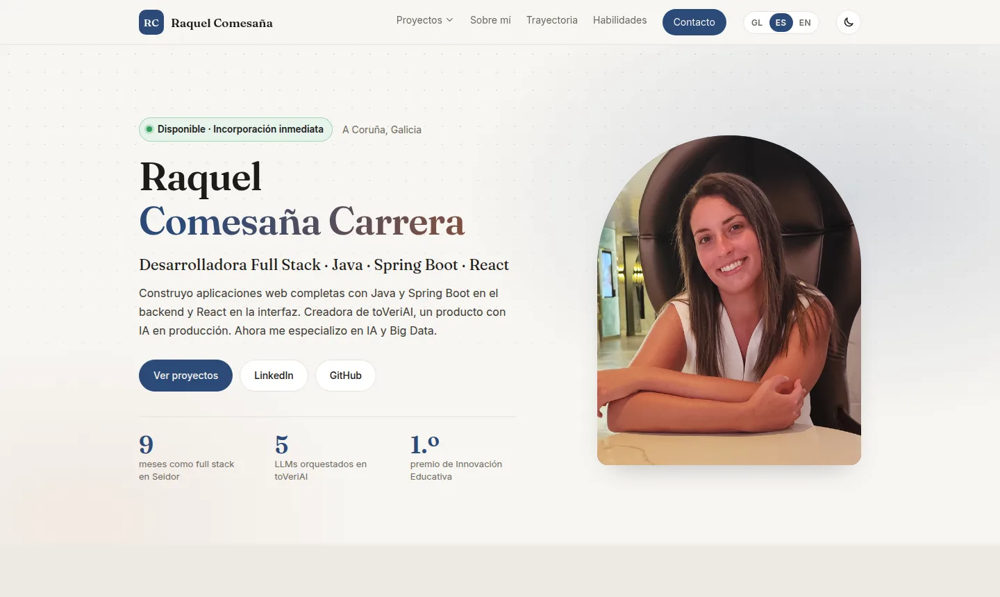
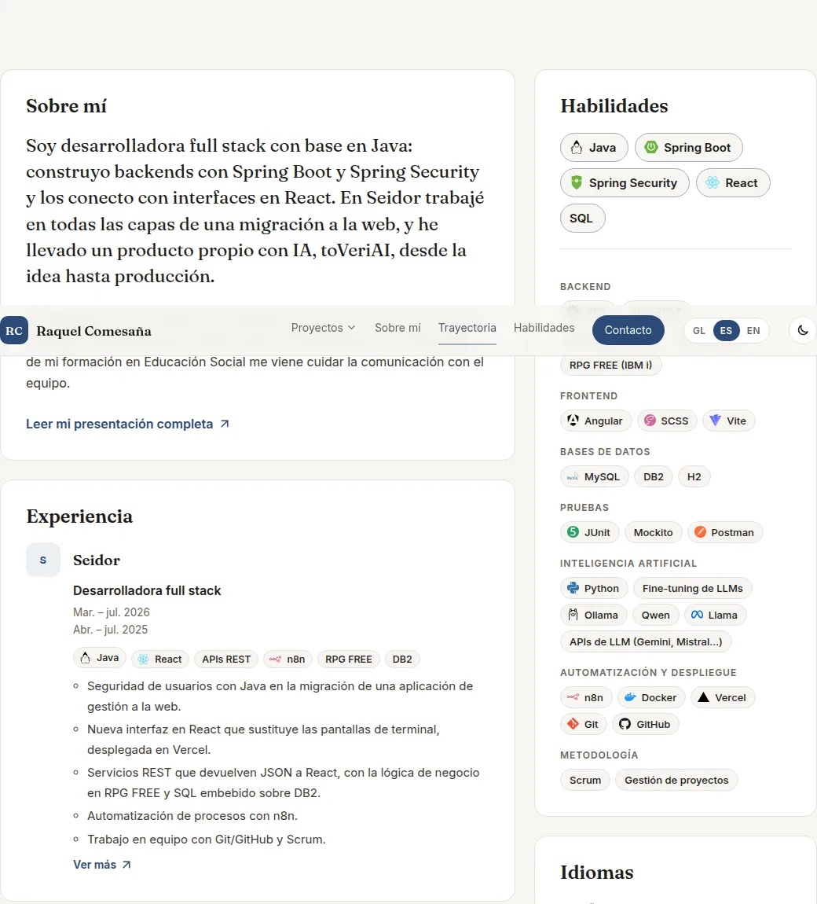
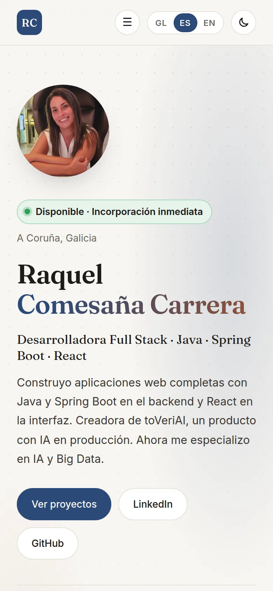

# Portfolio · Raquel Comesaña Carrera

Mi web personal como desarrolladora full stack (Java · Spring Boot · React): quién soy, mis proyectos, mi experiencia y cómo contactarme.

**👉 Ver la web:** <https://raquelccarreraa.github.io/Porfolio-raquelcarrera/>



<table>
  <tr>
    <td width="68%"></td>
    <td width="32%"></td>
  </tr>
  <tr>
    <td align="center"><sub>Perfil en dos columnas: trayectoria a la izquierda, habilidades a la derecha</sub></td>
    <td align="center"><sub>En el móvil</sub></td>
  </tr>
</table>

## Qué tiene

- **Portada** con disponibilidad, proyectos, sobre mí, experiencia, formación, habilidades, idiomas, colaboraciones y contacto.
- **Una página por proyecto** (toVeriAI y ArgaQuest) con cifras, capturas y secciones desplegables.
- **Una página por etapa** de la trayectoria (Seidor, la FP y la especialización en IA).
- **Tres idiomas:** gallego, castellano e inglés.
- **Tema claro y oscuro**, y diseño adaptado al móvil.
- **Direcciones legibles**, por ejemplo `…/proyectos/toveriai/`.

## Cómo está hecha

Sin frameworks ni dependencias: **HTML, CSS y JavaScript**. La idea es separar el contenido del diseño:

```
js/data.js  ──►  js/main.js  ──►  la página que ves
(qué digo)       (cómo lo pinto)
```

- `js/data.js` guarda **todo el contenido** en un objeto `CV`: textos, proyectos, experiencia, habilidades…
- `js/main.js` lee ese objeto y **genera el HTML** de cada sección en el idioma elegido.
- `css/styles.css` define **el aspecto**: colores, tipografías, tema oscuro y móvil.

Así, para cambiar un texto no hace falta tocar ni el HTML ni el diseño.

## Verla en tu ordenador

Desde la carpeta del proyecto:

```bash
python3 -m http.server 8000
```

y abre <http://localhost:8000/>. No hay nada que instalar.

> Abrir `index.html` con doble clic muestra la portada, pero las páginas de proyectos necesitan el servidor.

## Recetas para editar

### Cambiar un texto

1. Abre `js/data.js` y busca el texto.
2. Cámbialo en sus tres idiomas:
   ```js
   role: { gl: "Desenvolvedora Full Stack", es: "Desarrolladora Full Stack", en: "Full Stack Developer" }
   ```
3. Guarda y recarga la página.

> El nombre, el puesto y el resumen también están escritos en `index.html` (para buscadores y vistas previas al compartir el enlace). Si los cambias, cámbialos en los dos sitios.

Los textos de la interfaz (menú, botones, títulos) están en `UI`, al principio de `js/main.js`.

### Añadir una habilidad

Añádela en `CV.skills`, dentro de su categoría. Las más importantes van en `CV.core` y salen arriba, más grandes.

Si la tecnología tiene logo en `js/tech-icons.js` (sacados de [Simple Icons](https://simpleicons.org), licencia CC0), se muestra con él; si no, solo con el nombre.

### Añadir un proyecto o una etapa con página propia

1. Añade la entrada en `CV.projects`, o en `CV.experience` / `CV.education` con `slug` y `detail`.
2. Genera su carpeta:
   ```bash
   node herramientas/generar-paginas.js
   ```
   Crea `proyectos/<slug>/` o `trayectoria/<slug>/` a partir de `herramientas/plantilla.html`.

Las secciones de cada página se definen en `sections` y se muestran según lo que lleven: texto (`paragraphs`), lista (`list`), tarjetas con icono (`features`), pasos (`steps`), ficha técnica (`stack`), hitos (`milestones`) o prensa (`press`).

### Publicar los cambios

1. **Cambia la versión.** Si tocaste `styles.css`, `data.js`, `main.js` o `tech-icons.js`, cambia el número `?v=…` en `index.html`.
2. **Regenera las páginas** con `node herramientas/generar-paginas.js`, que copia esa versión al resto de páginas.
3. **Sube a `main`.** GitHub Pages publica la web en uno o dos minutos.

> El número de versión hace que los navegadores descarguen los archivos nuevos en vez de usar los que tienen guardados.

## Estructura

```
index.html            Portada
proyectos/<slug>/     Página de cada proyecto            (se genera)
trayectoria/<slug>/   Página de cada etapa                (se genera)
presentacion/         Presentación completa              (se genera)
herramientas/         generar-paginas.js y la plantilla de esas páginas
js/data.js            Todo el contenido
js/main.js            Pinta las páginas a partir de data.js
js/tech-icons.js      Logos de las tecnologías
css/styles.css        Estilos
assets/               Foto, capturas, logo de Galivelop y fuentes (licencia OFL)
docs/                 Capturas de este README
```

## Más detalles

<details>
<summary><strong>Idiomas</strong></summary>

El idioma se elige así:

1. `?lang=gl|es|en` en la dirección;
2. si no hay, el último elegido con el selector;
3. si no hay, el del navegador (si no es ninguno de los tres, inglés).

Para mandar la web en un idioma, comparte el enlace con `?lang=`, por ejemplo `…/Porfolio-raquelcarrera/?lang=en`. Al abrirlo, se guarda ese idioma y `?lang=` desaparece de la dirección.
</details>

<details>
<summary><strong>Modo borrador</strong></summary>

Las secciones con `draft: true` son huecos pendientes: llevan la pregunta en `ask` y **solo se ven añadiendo `?borrador=1`** a la dirección (por ejemplo `…/trayectoria/seidor/?borrador=1`). Quien visita la web no las ve.
</details>

<details>
<summary><strong>Cómo funcionan las páginas interiores</strong></summary>

Cada página interior es una carpeta con su `index.html`, para que la dirección se lea bien. Llevan `<base>` apuntando a la raíz, así que los enlaces y recursos se escriben igual que en la portada.
</details>

<details>
<summary><strong>Otros campos de <code>data.js</code></strong></summary>

- `availability`: la etiqueta «Disponible» de la portada.
- `myRole`: tu papel en la tarjeta de cada proyecto.
- `tags` en la experiencia: tecnologías bajo el puesto.
- `collab`: la tarjeta de Galivelop.
- `partner` y `overview` en toVeriAI: la nota de Galivelop y el botón «Ficha del proyecto».
- La formación sin página propia sale en «Otra formación», una línea por entrada.
</details>

## Contacto

[LinkedIn](https://www.linkedin.com/in/raquel-comesa%C3%B1a-carrera-1646ba195) · [GitHub](https://github.com/raquelccarreraA) · o desde la sección de contacto de la web.
